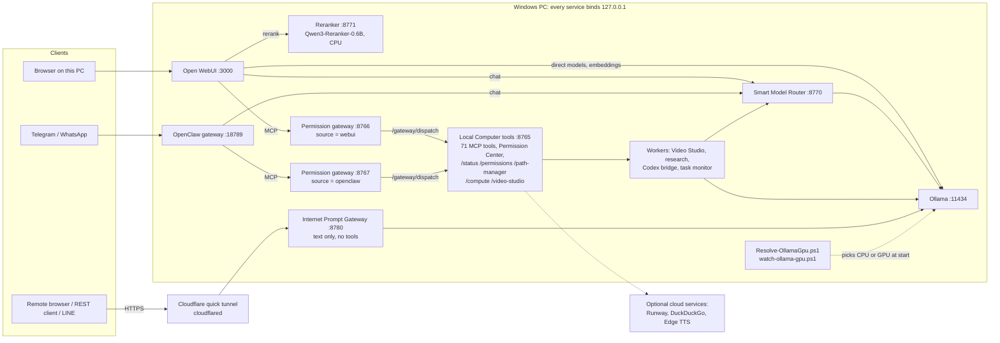
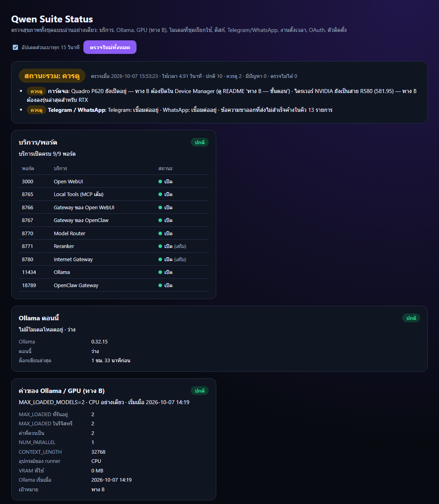
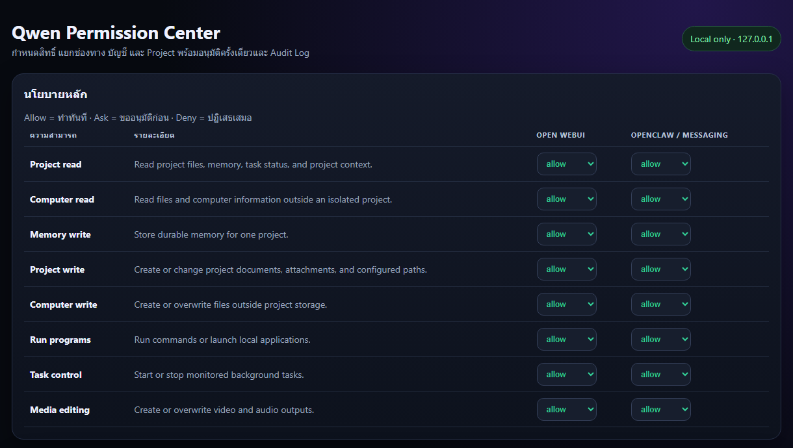
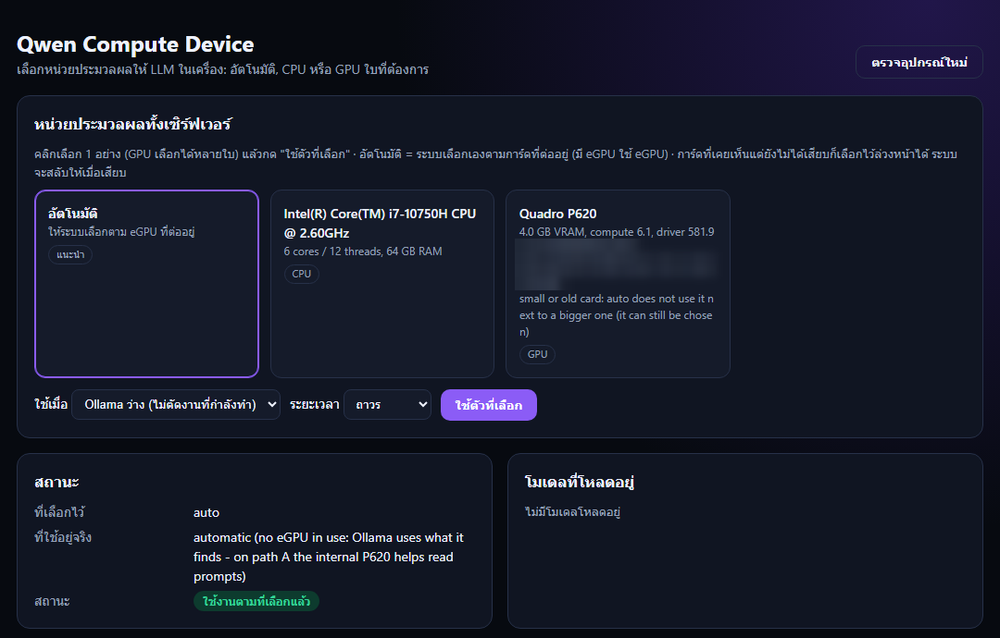
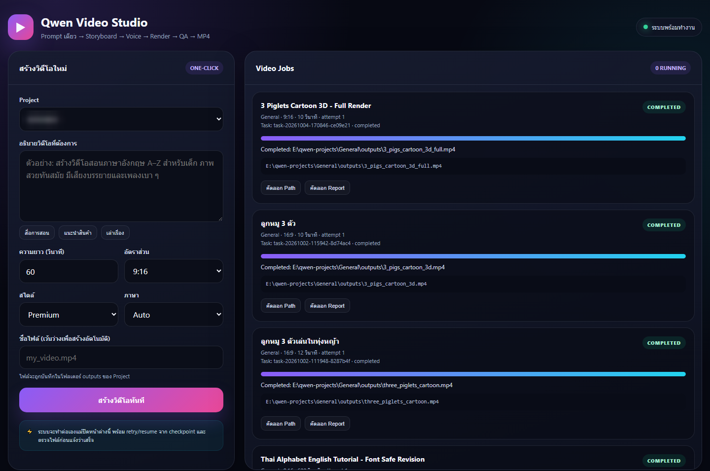

# Qwen Suite

Qwen Suite is a local, single-user AI workstation for Windows. It connects Ollama and Open WebUI to a set of Python and PowerShell services that run only on `127.0.0.1`: a model router, a reranker, MCP tool servers behind a permission gateway, a video pipeline, a web-research worker, a document knowledge base, Outlook read/draft tools and a bridge for the Codex CLI. Telegram and WhatsApp use the same tools through the OpenClaw gateway. An optional text-only gateway can be reached from the internet. The suite was built for one CPU-only Windows 10 laptop, and most of the user interface is in Thai. This repository contains the suite's own scripts and services only. Runtimes, models, user data and the installers are not included.

> **Status:** personal project, Windows only, with paths hard-coded to `E:\localllm`. Read [Project status and limitations](#project-status-and-limitations) before you try to run it. The owner's detailed operations manual (Thai) is [`README.md`](../README.md) in the repository root.
>
> **Unofficial project.** Not affiliated with or endorsed by Alibaba Cloud / Qwen, IBM, Meta, Ollama, Open WebUI, OpenClaw, OpenAI (Codex) or Runway. Product names belong to their owners.

## Features

### Chat and model routing

- Open WebUI 0.11 runs at `http://127.0.0.1:3000`. Sign-in is required and self-registration is turned off.
- The **Smart Model Router** (`:8770`) speaks the Ollama API and adds seven model profiles: `qwen-auto`, `qwen-general`, `qwen-code`, `qwen-fast`, `qwen-structured`, `qwen-agent` and `qwen-review`.
- `qwen-auto` picks a model for each request, using English and Thai keyword rules plus message length. The first matching rule wins:

  | Request | Model |
  |---|---|
  | Image or video input | `qwen3.8:27b` (vision) |
  | Code, repositories, debugging | `qwen3-coder:30b` |
  | "Important" requests | `qwen3.8:27b` writes the draft (see *Second pass* below) |
  | Review or second-opinion requests | `muse-glimmer:30b` |
  | Tool-calling turns | `muse-glimmer:30b` |
  | JSON, schemas, extraction, RAG | `granite4.2:8b` |
  | Long conversations (over 1,800 chars), research and "latest" questions | `qwen3.8:27b` |
  | Short messages (up to 320 chars) | `granite4.2:8b` |
  | Anything else | `qwen3.8:27b` |

  A follow-up with no intent words of its own keeps the coding route from the last three user turns. If a chosen model is not installed, the router uses an installed model with a similar role.
- **Second pass:** an "important" request sent to `qwen-auto` (for example "must be correct" or "ส่งผู้บริหาร") is drafted first, then checked and rewritten by Muse Glimmer (or the legacy `gpt-oss:20b` if Muse is missing and that model is installed). An important coding request is drafted by `qwen3-coder:30b` and gets the same second pass.
- **Runner-option normalisation:** the router removes `num_thread`, and also `shift` for models that cannot shift the KV cache. Every caller then loads a model with the same options, so moving between channels does not make Ollama reload a 17 GB model.
- **RAG:** hybrid search (BM25 weight 0.4) with `qwen3-embedding:4b` embeddings. The top 8 chunks are reranked to 4 by a local `Qwen3-Reranker-0.6B` service (`:8771`, CPU). Chunk size is 800 with an overlap of 120.
- Long chats are compacted, and chat titles are generated, with `qwen-fast` (Granite).
- Slash prompts `/plan`, `/review`, `/summary`, `/letter`, `/minutes` and `/drawing` (Thai), plus prompt suggestions.
- Voice input uses local faster-whisper with VAD. `ai-services/dictate.ps1` adds push-to-talk dictation anywhere in Windows (Ctrl+Alt+D through its Start Menu shortcut): it records the microphone, transcribes locally, copies the text to the clipboard and deletes the audio.
- Scripts added to Open WebUI: a dark theme, auto-continue for answers that were cut off (up to 6 segments) and buttons that open Projects & Tasks, Permission Center and Video Studio.

### Local tools and permission gateway

- `local-tools/server.py` (`:8765`) is an MCP server with **71 tools**. They cover files, projects and project memory, commands, background tasks, media, Office documents, PDFs, charts, reminders, research, Codex jobs, knowledge search, Outlook, screenshots, image generation, compute selection, suite status and web search.
- Two compact MCP gateways (`local-tools/fast_server.py`) expose only `local_read` and `local_action`. Port `:8766` serves Open WebUI and port `:8767` serves OpenClaw. Every call goes to `/gateway/dispatch` on `:8765`, where the **Permission Center** applies the policy for that source. `local_read` can batch up to five reads, and `action=help` returns the action catalogue. Keeping the always-attached schema small matters on a CPU: it shrank from 13,077 to 907 bytes.
- **Projects:** each project is an isolated folder under `E:\qwen-projects\<project>` with its own `MEMORY.md`, attachments and outputs. Named path aliases are either `read_only` or `read_write`.
- **Files:** targeted text edits (`edit_text_file`). A copy is saved before every edit or overwrite (files over 25 MB are not copied) and kept for 30 days, up to 300 MB in total. `revert_file_change` restores a copy, and the Path Manager shows the change list.
- **Commands:** `run_command` accepts a fixed set of program aliases (cmd, powershell, conda, python, git, ffmpeg/ffprobe/ffplay, VS Code, Explorer), and every call passes the command policy. Long jobs use `start_project_task`, which keeps a persistent task registry with logs, status and end-of-task notifications. Each project can save up to 9 named actions.
- **Documents:**
  - Create Word, Excel, PowerPoint or PDF files from Markdown or JSON (Thai text is set in TH Sarabun New).
  - Edit existing Office files into a new copy. Excel formulas are recalculated through LibreOffice.
  - PDF tools: merge, split, extract, rotate, fill forms, and render pages to PNG.
  - PNG charts.
  - Thai templates `memo-th` and `report-th`, plus templates saved from the user's own files.
- **Local web pages on `:8765`:** `/path-manager`, `/permissions`, `/compute`, `/video-studio` and `/status`.
- **Notifications:** when background work ends, the owner gets a Windows toast, a Telegram message, or both.
- **Reminders:** a Thai/English time parser, delivered to Telegram by an OpenClaw automation with no model call.
- **Screenshots:** `capture_screen` saves a PNG to the project's outputs folder.

### Video Studio

- A single prompt starts one monitored job, either through `generate_video` or at `http://127.0.0.1:8765/video-studio`. The job runs these steps:
  1. **Storyboard:**
     - English uses `granite4.2:8b`.
     - Thai uses an instant built-in template, unless a large GPU (20 GB or more) is present.
     - With a large GPU, `qwen3.8:27b` writes the storyboard.
  2. **Scene cards:** rendered with Pillow.
  3. **Narration:** Microsoft Edge online voices. If those fail, the offline Windows SAPI voice is used.
  4. **Background music:** generated tones, ducked under the narration.
  5. **Subtitles:** selectable `mov_text` subtitles.
  6. **Video:** an H.264 MP4 in 9:16, 16:9 or 1:1.
  7. **Quality checks:** loudness measurement, preview frames and stream checks.
- Six visual styles are available.
- Each step leaves a checkpoint. Failed jobs resume automatically, up to three attempts. A supervisor keeps the Open WebUI chat attached to the job across page refreshes.

### Research

- `start_research` runs unattended web research and produces a Word report:
  1. Search DuckDuckGo through `ddgs`.
  2. Fetch the result pages, but only from hosts with public IP addresses.
  3. Write notes for each source.
  4. Write the synthesis.
  5. Check citations: every `[n]` must point to a page that was actually fetched. The reference list is built by code, not by the model.
- The model phase waits until Ollama has been idle for 15 minutes, or for the 01:00-05:00 window. Checkpoints allow `resume_id`. Up to 3 jobs can be active at once.

### Image generation

- `generate_image` takes `provider=auto|local|runway`:
  - **Local:** Qwen-Image 2.1 is used only when its optional pack is installed. The pack records the install after a CUDA check passes. The pack is not part of this repository.
  - **Runway:** `gen4_image` through a developer API key that the owner stores in `data\credentials\runway-api-key.txt`. Each image costs credits: 5 at 720p, 8 at 1080p.
  - **Fallback rules:** `auto` falls back to Runway only when the local pack cannot run (no CUDA, out of memory) and the request has no `seed` and no local reference image. `local` never falls back.
- Open WebUI is also set up with two Runway MCP connections. The owner signs in with OAuth after installation.

### Knowledge base

- A BM25 keyword index over PDF, DOCX, XLSX/XLSM, PPTX and text files:
  - Thai text is indexed as character trigrams and CJK as bigrams.
  - Pages without a text layer get Tesseract OCR.
  - Rebuilds are incremental.
  - Values that look like credentials are redacted before indexing.
  - Source files are opened read-only.
- Queries need no model and return file, page, sheet and row locators. They are available through `search_knowledge` and `list_knowledge` in chat, or the `knowledge_base.py build|search|create|list` CLI.

### Outlook

- Uses classic Outlook through COM:
  - Calendar agenda for up to 14 days.
  - Mail search.
  - `outlook_create_draft`, which saves to Drafts. The module never calls `Send`.
- Every COM call runs in a child process with a 45-second limit. Mail and calendar text is labelled as untrusted for the model.
- **Morning brief:** `local-tools/morning_brief.py` prints a fixed-format Thai summary with no model involved: the date, today's calendar, unread mail, reminders and a one-line suite status. It is meant to run as an OpenClaw automation (`qwen-morning-brief`, 07:00) that posts to Telegram.

### Codex bridge

- `local-tools/codex/` runs the OpenAI Codex CLI against local Ollama (`qwen3-coder:30b`), with its own `CODEX_HOME` generated from a template:
  - Analytics, web search and cloud features are off.
  - A dead proxy (`127.0.0.1:9`) is a best-effort block on network access for the commands it runs.
- `Invoke-QwenCodex.ps1` modes:
  - `-Exec`: one job; read-only by default.
  - `-Review`: reviews uncommitted changes, a branch or a commit and writes a Markdown report; `-Docx` adds a Word copy.
  - `-Tui`: interactive session.
  - `-List`, `-Check`: list recent jobs, check the setup.
  - JSON output-schema validation and `-ResumeLast` are also supported.
- **Write jobs** need `write_mode` in `data\codex-bridge.json`. The default is `disabled`; the alternatives are `windows-sandbox` and `full-access`.
- **Policy hook:** a `PreToolUse` hook (`policy_hook.py`) applies the same command policy as `run_command`. The bridge self-tests the hook and checks its trust before every job, and refuses write jobs if either check fails.
- **From chat:** `start_codex_job`, `get_codex_job` and `list_codex_jobs`. Jobs from chat are refused in the suite folder, the profile root, AppData, drive roots and secret folders. If a job touched a secret path, its answer is not shown in chat; in other answers, strings that look like secrets are masked.

### Telegram and WhatsApp via OpenClaw

- `Configure-OpenClaw.py` writes the OpenClaw configuration:
  - Agent `qwenlocal` on `ollama/qwen-auto:latest`, routed through `:8770`.
  - Gateway on `127.0.0.1:18789` with token authentication.
  - Telegram, WhatsApp and LINE channels are all created **disabled** until the owner links them. Once linked: Telegram uses DM pairing, WhatsApp an allowlist plus self-chat, and groups stay off.
  - Local tools through the `:8767` permission gateway.
- Voice notes are transcribed locally. faster-whisper `small` is used when it is installed and the clip fits the time budget; otherwise `base`.
- Voice replies use local Thai TTS (MMS-TTS Thai).
- Memory search is keyword-only (trigram), so no memory text is sent to an embeddings API.
- Skills: `/plan`, `/letter`, `/minutes`, `/drawing` and `/qstatus`. `/model` switches between the router profiles.
- `openclaw-tools/Connect-OpenClaw-Channels.ps1` is an interactive menu for linking Telegram, WhatsApp and LINE.

### Remote access via the internet gateway

- `internet-gateway/server.py` (`:8780`) is a text-only prompt gateway. It uses a fixed model (`qwen3.8:27b`) and **sends no tools** to the model.
- It is published through a Cloudflare quick tunnel (`cloudflared`, random `*.trycloudflare.com` URL).
- A watchdog checks the tunnel's `/ready` endpoint every 120 seconds and backs off when repairs fail. When the URL changes, the owner is notified (Telegram and toast) and the LINE webhook is registered again.
- It offers a web client, a REST API and LINE:
  - REST: `POST /api/v1/prompt` with a Bearer key and an `Idempotency-Key`, job polling, and `/continue`.
  - LINE: a Messaging API webhook with an HMAC-SHA256 check and a pairing code that expires after 30 minutes.
- Optional web search (`ddgs`) with cited sources.
- Per-session memory is stored in SQLite and kept for 30 days.
- Limits: 2 active jobs and 20 jobs per hour per source, and a 30-minute job timeout.
- The setup page (`/local/setup`, which shows the API key and pairing code) only answers direct loopback requests.

### Health dashboard

- `http://127.0.0.1:8765/status`, the `suite_status` chat action, Telegram `/qstatus` and `local-tools/Test-QwenSuite.ps1` all show the same read-only report from `local-tools/suite_health.py`. It covers:
  - Ports.
  - Ollama's current state, with tokens/s and an ETA.
  - Ollama and GPU configuration.
  - **Models:** every model tag named in the suite's code and config, compared with what Ollama has installed.
  - Display adapters.
  - Disk space.
  - Telegram and WhatsApp.
  - OpenClaw automations.
  - OAuth expiry.
  - README tool count.
  - Installer payload.
  - Stuck processes.
- It never restarts anything or loads a model, and stops after about 15 seconds. Tokens, keys, emails and IDs are redacted. The page refreshes the light checks every 15 seconds and only accepts its own `Host` header.
- `Test-QwenSuite.ps1` exit codes: `0` normal, `1` worth a look, `2` problem, `3` check could not run.

### eGPU / CPU auto-selection

- `Resolve-OllamaGpu.ps1` runs before every Ollama start:
  - **Usable NVIDIA GPU present** (compute capability ≥ 7.0, ≥ 6 GiB, driver ≥ 550): Ollama gets only that card, by UUID, with the `cuda_v12` library and Vulkan off.
  - **No usable GPU:** Ollama runs CPU-only (or keeps its own GPU discovery).
  - The decision goes to `data\gpu-profile.json`, which the router and the video worker read.
- `watch-ollama-gpu.ps1` checks every 45 seconds for a card being plugged in or pulled out, and for sleep while an eGPU was in use. It restarts Ollama when Ollama is idle, with a rate limit.
- **Manual choice:**
  - `Select-QwenCompute.ps1`, the `/compute` page or the chat tool `compute_device`: `auto`, `cpu` or a specific GPU, optionally for a set number of hours.
  - `Set-QwenModelPlacement.ps1` pins one model to the CPU, and the change can be undone byte for byte.
  - The User environment variable `QWEN_GPU_MODE` (`auto|cpu|all|vulkan`) overrides the automatic choice.
- **Diagnostics:** `Test-QwenGpu.ps1` (report, `-SelfTest`, `-Bench`, `-EvictionCheck`) and `bench.ps1`, which runs without unloading models.

### Installers

- Offline and Online installers (current release 1.6.1) are built from a separate installer project and distributed separately. They are **not** part of this repository.
- The installers run `Configure-Qwen-WebUI.py` and `Configure-OpenClaw.py` from this repository to apply the suite's settings.

## Architecture



| Port | Service | Started by |
|---|---|---|
| 3000 | Open WebUI | `start-webui.ps1` |
| 8765 | Local Computer tools: 71 MCP tools, web pages, `/gateway/dispatch` | `local-tools/start-local-tools.ps1` |
| 8766 | Permission gateway for Open WebUI | `local-tools/start-local-tools.ps1` |
| 8767 | Permission gateway for OpenClaw | `local-tools/start-local-tools.ps1` |
| 8770 | Smart Model Router | `ai-services/start-ai-services.ps1` |
| 8771 | Qwen3 Reranker | `ai-services/start-ai-services.ps1` |
| 8780 | Internet Prompt Gateway (the only service behind the tunnel) | `internet-gateway/start-internet-gateway.ps1` (via the watchdog that `start-webui.ps1` launches) |
| 11434 | Ollama | `start-ollama-server.ps1` / `Start-Ollama.ps1` |
| 18789 | OpenClaw gateway | OpenClaw (`Start-Qwen-All-in-One.ps1` starts it if needed) |

## Screenshots

The local web pages are served by the tools server on `http://127.0.0.1:8765`. The UI text is Thai. Machine-specific values (a GPU UUID and a project name) are blurred.

**Health dashboard** (`/status`): overall status, open warnings and one card per check (ports, Ollama, GPU path, models, disk, chat channels, automations, OAuth, installer payload).



**Models check:** every model the suite's code and config refer to, which component needs it, and whether Ollama has it installed.


**Permission Center** (`/permissions`): `allow` / `ask` / `deny` per capability, separately for Open WebUI and OpenClaw (Telegram/WhatsApp), with one-time approvals and an audit log.



**Compute device** (`/compute`): choose automatic, CPU-only or a specific GPU for Ollama, and see what is loaded right now.



**Video Studio** (`/video-studio`): one prompt becomes a monitored job (storyboard, scene cards, narration, music, subtitles, MP4, QA) with resumable checkpoints.



## Requirements

- **OS:** Windows 10 (tested) or 11, 64-bit, with Windows PowerShell 5.1. The scripts use COM, DPAPI, WinRT toasts and `pywin32`, so the suite does not run on Linux or macOS.
- **CPU and RAM:** the reference machine has an Intel i7-10750H (6 cores) and 64 GB RAM. `qwen3.8:27b` (Q4_K_M) has about 17 GB of weights and needs about 18-20 GB of RAM while loaded. Smaller machines have not been tested.
- **Disk:** plan for tens of GB of models. The 1.3 offline installer set alone was about 58 GB, and the optional Qwen-Image 2.1 pack needs at least 50 GB more.
- **GPU (optional):** an NVIDIA GPU with compute capability ≥ 7.0, ≥ 6 GB VRAM and a driver ≥ 550 is used automatically. A 24 GB card is recommended for Muse Glimmer and Qwen-Image. Qwen-Image needs CUDA. Without a GPU everything runs on the CPU, slowly (see [limitations](#project-status-and-limitations)).
- **Software (source install):**
  - Ollama (developed against 0.32.x).
  - Python 3.11 with Open WebUI 0.11.0 in `webui-venv`.
  - The OpenClaw runtime (Node) in `openclaw-runtime`.
  - FFmpeg.
  - Optional, depending on the features you use: `cloudflared` (tunnel), LibreOffice (PDF export, Excel recalculation), Tesseract (OCR), an Anaconda Python with matplotlib (charts), classic Outlook, Microsoft Edge (OpenClaw browser) and the Codex app/CLI (Codex bridge).

## Installation

### Option A: installers

Use the Offline or Online installer (1.6.1). They are distributed separately from this repository. They install the runtimes and, in the offline build, the models. They then apply the configuration with the `Configure-*.py` scripts. After installation, sign in at `http://127.0.0.1:3000` and change the default password (see [Security model](#security-model)).

### Option B: from source (manual)

There is no bootstrap script. The steps below describe what the scripts expect:

1. Clone into `E:\localllm`. More than 30 tracked files reference that path, and several reference `E:\qwen-projects` and `C:\Users\<user>`.
2. Install Ollama. Set the User environment variables the launchers read: `OLLAMA_MODELS`, `OLLAMA_CONTEXT_LENGTH=32768`, `OLLAMA_KEEP_ALIVE=2h`, `OLLAMA_FLASH_ATTENTION=1` and `OLLAMA_MAX_LOADED_MODELS=2`.
3. Pull the models the suite names:

   ```powershell
   ollama pull qwen3.8:27b
   ollama pull qwen3-coder:30b
   ollama pull granite4.2:8b
   ollama pull muse-glimmer:30b
   ollama pull qwen3-embedding:4b
   ```

4. Create `E:\localllm\webui-venv` (Python 3.11) and install `open-webui`. Also install the packages the services import that Open WebUI may not bring:
   - `mcp`, `fastapi`, `uvicorn`, `httpx`, `requests`, `psutil`, `pywin32`, `Pillow`
   - `python-docx`, `openpyxl`, `python-pptx`, `pymupdf`, `ddgs`, `beautifulsoup4`, `lxml`, `jsonschema`
   - `torch`, `transformers`, `huggingface_hub`, `faster-whisper`, `bcrypt`, `edge-tts`
   - `internet-gateway/requirements.txt`
5. Download the local helper models into `model-cache\`:
   - `webui-venv\Scripts\python.exe ai-services\Download-Reranker.py --target E:\localllm\model-cache\Qwen3-Reranker-0.6B`
   - faster-whisper `small` and/or `base` into `model-cache\faster-whisper-small|base`
   - `facebook/mms-tts-tha` into `model-cache\mms-tts-tha`
6. Start the core services with `powershell -ExecutionPolicy Bypass -File E:\localllm\start-webui.ps1`. This one script starts Ollama, the local tools, the router, the reranker and the tunnel watchdog, injects the theme, then serves Open WebUI.
7. Once Open WebUI has created its database, apply the suite settings:
   - `webui-venv\Scripts\python.exe Configure-Qwen-WebUI.py --db E:\localllm\webui-data\webui.db`
   - After installing OpenClaw into `openclaw-runtime\`: `webui-venv\Scripts\python.exe Configure-OpenClaw.py --root E:\localllm`
8. Day-to-day:
   - `Start-Qwen-All-in-One.ps1` starts everything and opens the browser.
   - `Stop-Qwen-Suite.ps1` or `stop-all.ps1` stops everything and frees the RAM. Both also stop Ollama's `llama-server` children.
   - `openclaw-tools\Connect-OpenClaw-Channels.ps1` links the chat channels.

## Configuration

- **Ports:** see the [table above](#architecture). All services bind `127.0.0.1`. Open WebUI uses 3000 rather than 8080 because 8080 was taken on the reference machine.
- **Permission Center:** `http://127.0.0.1:8765/permissions`. Eight categories (project read, computer read, memory write, project write, computer write, run programs, task control, media editing) can each be set to `allow`, `ask` or `deny`, separately for `webui` and `openclaw`. Scoped policies per sender or project are also supported. `ask` creates a one-time approval that expires after 15 minutes. Every decision is written to `audit.jsonl`.
- **Owner-editable files** (all under the git-ignored `data\`):

  | File | Purpose |
  |---|---|
  | `data\permission-center\command-rules.json` | Extra blocked-command rules (seeded from `local-tools\default-command-rules.json`, reloaded on change) |
  | `data\permission-center\hooks.json` | Owner Pre/Post hooks. Pre hooks can only block; they fail open after 5 s |
  | `data\compute-selection.json`, `data\model-placement.json` | CPU/GPU choice and per-model CPU pins |
  | `data\codex-bridge.json` | Codex bridge `write_mode` and models |
  | `data\notify.json`, `data\dictate.json` | Notification channels; dictation microphone and language |
  | `data\credentials\runway-api-key.txt` | Runway developer key (owner-created; blocked for the model's file tools) |
  | `local-tools\allowed-roots.json` | Folders the file tools may use (default: user profile, suite folder, `E:\qwen-projects`, Documents) |

- **Environment variables:** `QWEN_GPU_MODE`, `QWEN_WHISPER_MODEL`, `QWEN_WHISPER_BUDGET_SECONDS`, `QWEN_RESEARCH_IDLE_MINUTES`, `QWEN_OUTLOOK_ALLOW_START`, `QWEN_OUTLOOK_TIMEOUT` and `QWEN_TESSERACT`. The `OLLAMA_*` variables are read from the User environment by the launchers.
- **Excluded from git:** `.gitignore` is an allowlist. Only the top-level scripts and `ai-services/`, `internet-gateway/`, `local-tools/`, `openclaw-tools/` and `theme/` are tracked. Everything else stays local, including:
  - Data and secrets: `data\`, `webui-data\`, `internet-gateway\data\`, `.webui_secret_key`, `allowed-roots.json`.
  - Logs and caches: `logs\`, `backups\`, `hf-cache\`, `model-cache\`.
  - Runtimes: `webui-venv\`, `openclaw-runtime\`, `runtime\`.
  - Workspaces: `openclaw-workspace\`.
  - File types: databases, `.env`, keys, `credentials*`, archives and binaries.

## Security model

This is a single-owner setup that deliberately trades confirmations for convenience. Read this section before connecting any chat channel.

- **Loopback only.** Open WebUI, the tool servers, router, reranker, internet gateway, Ollama and the OpenClaw gateway all bind `127.0.0.1`. Open WebUI accepts browser API calls only from its own origin (`CORS_ALLOW_ORIGIN`). The `:8765` JSON endpoints refuse cross-origin posts, and the status API refuses foreign `Host` headers.
- **Login.** Open WebUI requires a password and has self-registration disabled. The configuration script creates the owner account **`admin@localhost`** with a default password. **Change it at the first sign-in** (Settings > Account). The default password is not printed here, but anyone with the source can read it, so treat it as public.
- **The Permission Center allows everything by default.** For both `webui` and `openclaw`, all eight categories default to **Allow**. As a result, a message from an allowed Telegram/WhatsApp sender can run local commands, write files and start tasks **without a confirmation prompt**. This is the owner's deliberate choice. Set categories to `ask` or `deny` if you want a different trade-off. The protections that still apply under Allow are listed next.
- **Hard blocks, independent of policy:**
  - **File tools:**
    - Limited to the allowed roots.
    - Refuse credential and agent-state folders (`.ssh`, `.aws`, `credentials`, browser `Login Data`/`Cookies`, `.codex`, `.openclaw`, `.claude`).
    - Refuse Open WebUI's database and secret key.
  - **Command policy** (`local-tools/command_policy.py`):
    - Blocks format/diskpart/bcdedit, shutdown, recursive deletes, killing the AI services, credential-store access, agent-state folders, and disk or shadow-copy destruction.
    - Unwraps `powershell -Command`, `-EncodedCommand` (base64), `-File`, `cmd /c` and `python -c`, and normalises aliases before checking.
  - **Limits of these blocks:** this is a block-list, not a sandbox. A script that is already on disk can still do anything the user can.
- **Codex bridge:** write jobs are off by default. In `full-access` mode the model's commands run with the user's full rights, and only the policy hook and the dead proxy stand in the way.
- **Chat channels:** OpenClaw uses DM pairing for Telegram and an allowlist/self-chat for WhatsApp, with groups disabled. Its gateway uses token auth on loopback.
- **Internet gateway:**
  - The only internet-facing path. It sends no tools to the model, so remote prompts cannot control the computer.
  - **Access:** requests need a random API key (Bearer). LINE requests are verified with HMAC-SHA256, and LINE secrets are encrypted with Windows DPAPI.
  - **Limits:** rate and queue limits apply.
  - **Exposure:** the quick-tunnel URL is public and changes on restart, so anyone with the URL and the key can use the model.
- **What leaves the machine:**
  - Web search queries and fetched pages: DuckDuckGo via `ddgs` (research worker, internet gateway), Open WebUI's own web search and web loader, and OpenClaw's `web_fetch` and Edge `browser` tools.
  - Runway prompts and reference images, when Runway is used (the `gen4_image` API and the two Runway MCP connections at `mcp.runwayml.com`).
  - Video narration text, sent to Microsoft's online Edge TTS.
  - Telegram, WhatsApp and LINE messages, including files and screenshots sent back to Telegram.
  - Tunnel traffic through Cloudflare.
  - Open WebUI telemetry is switched off (`ANONYMIZED_TELEMETRY=False`, `DO_NOT_TRACK`, `SCARF_NO_ANALYTICS`).

## Model and component licences

Models and runtimes are **not** distributed in this repository. Each is downloaded separately under its own licence.

| Component | Used for | Licence |
|---|---|---|
| Qwen3.8 27B (`qwen3.8:27b`) | General chat, vision, default model | Apache-2.0 |
| Qwen3-Coder 30B (`qwen3-coder:30b`) | Coding, Codex bridge | Apache-2.0 |
| Granite 4.2 8B (`granite4.2:8b`) | Fast/structured/RAG answers, titles, compaction | Apache-2.0 |
| Muse Glimmer 30B (`muse-glimmer:30b`) | Agent and second-opinion review | Apache-2.0 according to its ollama.com page (**to be confirmed** against the upstream model card) |
| Qwen3-Embedding 4B (`qwen3-embedding:4b`) | RAG embeddings | Apache-2.0 |
| Qwen3-Reranker-0.6B | RAG reranking | Apache-2.0 |
| faster-whisper small / base | Speech-to-text | MIT |
| MMS-TTS Thai (`facebook/mms-tts-tha`) | Thai voice replies on Telegram/WhatsApp | **CC BY-NC 4.0: non-commercial use only** |
| Qwen-Image 2.1 (optional pack) | Local image generation | **Qwen Research License: non-commercial (research/evaluation) only.** Commercial use needs a separate licence |
| Open WebUI 0.11 | Chat UI | Open WebUI License (BSD-3-Clause based, with a **branding clause**: do not remove or alter "Open WebUI" branding unless the deployment has ≤ 50 users in 30 days, or you have written permission or an enterprise licence). The bundled theme restyles the UI but does not rename it |
| Ollama | Model server | MIT |
| OpenClaw | Telegram/WhatsApp/LINE gateway | MIT |
| PyMuPDF (`pymupdf`, imported, not included) | PDF tools, knowledge base, research | **AGPL-3.0** or a commercial licence from Artifex. This repository only imports it; an installer that bundles it takes on AGPL obligations |
| Runway API, Edge TTS | Cloud image generation, video narration | Commercial online services under their providers' terms |

Licences were checked on the public model pages in October 2026. Confirm each one on its model card before any commercial use.

## Project status and limitations

- **Personal, single-machine project.** It is tuned for one laptop: hard-coded paths (`E:\localllm`, `E:\qwen-projects`, `C:\Users\<user>\...`), Anaconda locations and VS Code paths. Moving it means editing those paths.
- **Windows only.**
- **Thai-first:** the web pages and most prompts and messages are in Thai.
- **CPU-only performance is slow:**
  - `qwen3.8:27b` reads prompts at about 5-6 tokens/s and writes at about 1.4-1.9 tokens/s on the reference CPU.
  - A cold OpenClaw prompt (about 20k tokens) takes 13-23 minutes to read.
  - Ollama serves one request at a time, so research and Codex jobs wait for idle time.
  - The eGPU speed figures in the docs are estimates. The eGPU path has not been benchmarked on this machine.
- **Known issue (1.6.1):** `local-tools/project_store.py` still signs in to Open WebUI with the pre-1.6.1 credentials. Syncing project folders, memory and attachments into Open WebUI therefore fails. Local files and `MEMORY.md` are still written. A fix is planned for 1.6.2.
- **Not yet verified end to end:** Codex tool-calling quality with `qwen3-coder:30b`, and a full research run.
- **Fragile external pieces:**
  - Quick-tunnel URLs change on every restart and have no SLA.
  - `ddgs` search is best-effort.
  - Outlook support is classic Outlook (COM) only.
- **Packaging gaps:**
  - There is no consolidated `requirements.txt` and no bootstrap script.
  - Automated tests cover the internet gateway (24 `unittest` cases), the GPU decision logic (`Test-QwenGpu.ps1 -SelfTest`) and the Codex policy hook (`policy_hook.py --selftest`, run before every Codex job).

## Repository layout

```text
*.ps1, Configure-*.py   launchers, stop scripts, GPU selection, benchmarks, configuration
ai-services/            model router (:8770), reranker (:8771), speech-to-text, Thai TTS, dictation
local-tools/            MCP tools (:8765), permission gateways (:8766/:8767), workers, web pages
local-tools/codex/      Codex CLI bridge (templates, policy hook, job tracking)
internet-gateway/       internet prompt gateway (:8780), quick tunnel and watchdog, tests
openclaw-tools/         OpenClaw launch and channel scripts, chat skills
theme/                  Open WebUI theme and add-on scripts
```

## License

The suite's own code is released under the [MIT License](../LICENSE). The third-party models, runtimes and services listed in [Model and component licences](#model-and-component-licences) keep their own licences.
