<div align="center">

# Qwen Suite

**A private, local-first AI workstation for Windows**

Local LLMs on Ollama and Open WebUI · 72 tools behind a permission gateway<br>
Telegram, WhatsApp and LINE · Video Studio · Codex · every service on `127.0.0.1`


<a href="#screenshots">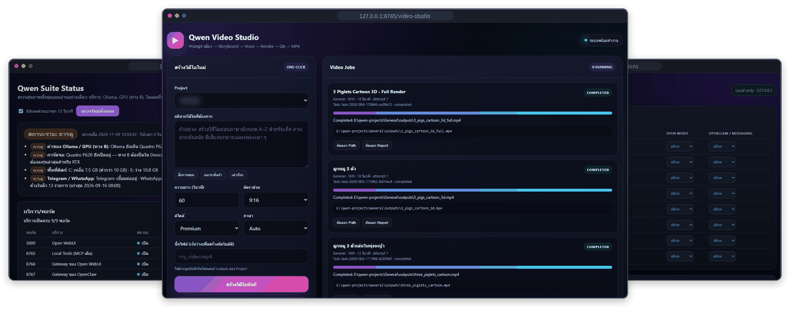</a>

**[Screenshots](#screenshots)** · **[Features](#features)** · **[What's new](#whats-new-in-162)** · **[Architecture](#architecture)** · **[Installation](#installation)** · **[Security](#security-model)** · **[Changelog](../CHANGELOG.md)**

</div>

Qwen Suite is a local, single-user AI workstation for Windows. It connects Ollama and Open WebUI to Python and PowerShell services that run only on `127.0.0.1`: a model router, a reranker, MCP tool servers behind a permission gateway, a video pipeline, a research worker, a document knowledge base, Outlook tools and a bridge for the Codex CLI. Telegram and WhatsApp reach the same tools through the OpenClaw gateway. This repository holds the suite's own scripts and services; runtimes, models, user data and the installers are not included.

> [!NOTE]
> A personal project for one CPU-only Windows 10 laptop, with paths hard-coded to `E:\localllm`, and most of the interface is in Thai. Read [Project status and limitations](#project-status-and-limitations) before you try to run it. The owner's detailed operations manual (Thai) is [`README.md`](../README.md).

## Screenshots

<table>
  <tr>
    <td width="50%" valign="top">
      <a href="../docs/screenshots/health-dashboard.png">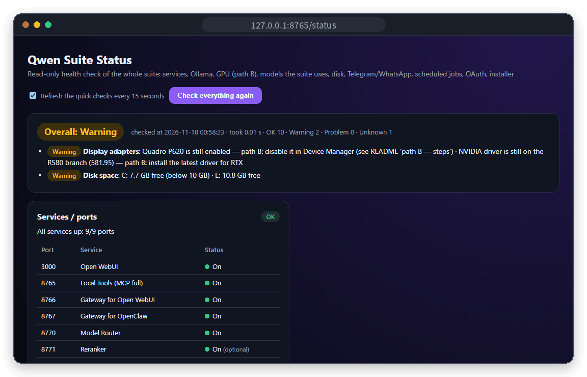</a>
      <p><b>Health dashboard</b> &nbsp;<code>/status</code><br>
      <sub>Overall status with the open warnings, every port, what Ollama is doing and the GPU path.</sub></p>
    </td>
    <td width="50%" valign="top">
      <a href="../docs/screenshots/permission-center.png">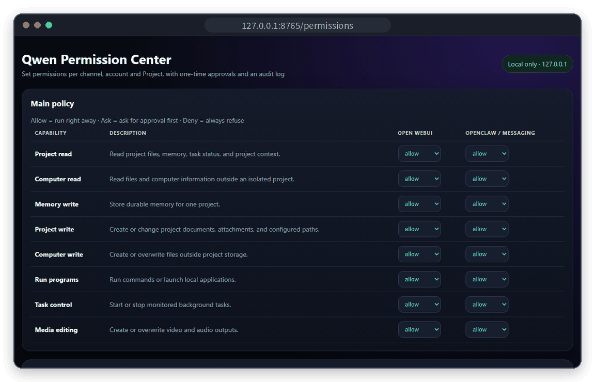</a>
      <p><b>Permission Center</b> &nbsp;<code>/permissions</code><br>
      <sub>Allow, ask or deny for each capability, separately for Open WebUI and for Telegram/WhatsApp, with scoped rules and an audit log.</sub></p>
    </td>
  </tr>
  <tr>
    <td width="50%" valign="top">
      <a href="../docs/screenshots/compute-center.png">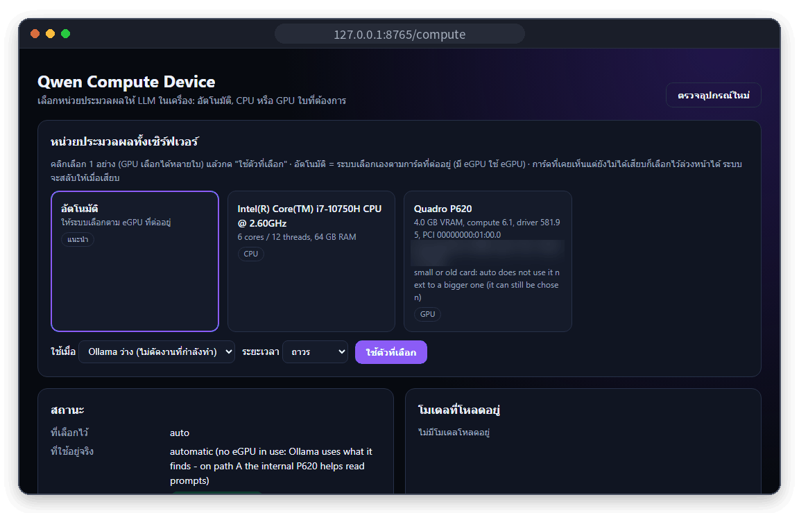</a>
      <p><b>Compute device</b> &nbsp;<code>/compute</code><br>
      <sub>Automatic, CPU-only or a chosen GPU for Ollama, and per-model CPU pins.</sub></p>
    </td>
    <td width="50%" valign="top">
      <a href="../docs/screenshots/projects-and-tasks.png">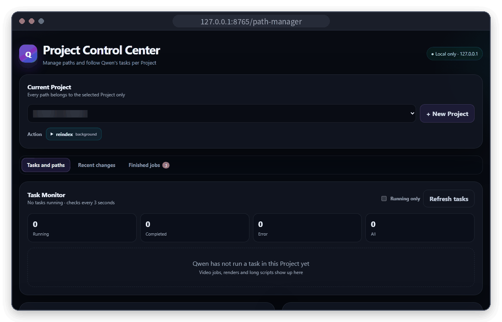</a>
      <p><b>Projects &amp; Tasks</b> &nbsp;<code>/path-manager</code><br>
      <sub>The current project with its allowed paths and actions, the task monitor, recent file changes and finished jobs.</sub></p>
    </td>
  </tr>
  <tr>
    <td width="50%" valign="top">
      <a href="../docs/screenshots/video-studio.png">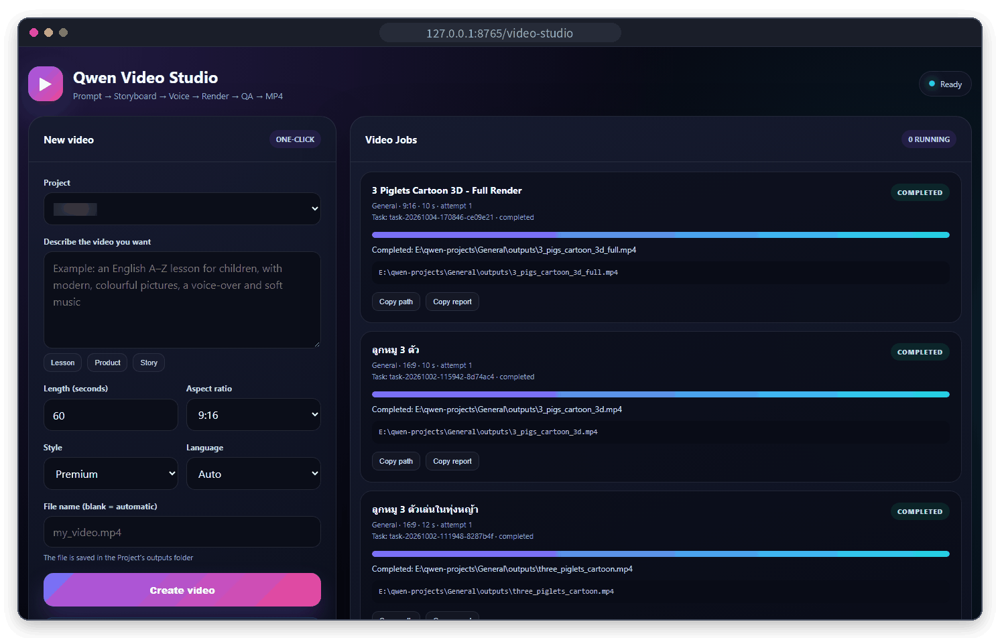</a>
      <p><b>Video Studio</b> &nbsp;<code>/video-studio</code><br>
      <sub>One prompt becomes a monitored job: storyboard, scenes, narration, music, subtitles, MP4 and QA, with resumable checkpoints.</sub></p>
    </td>
    <td width="50%" valign="top">
      <a href="../docs/screenshots/cards/desktop-app-status.png">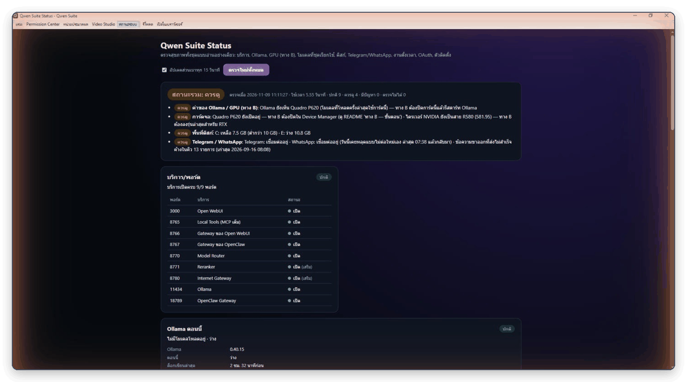</a>
      <p><b>Qwen Suite Desktop</b><br>
      <sub>One window with tabs for chat, Permission Center, compute device, Video Studio and status.</sub></p>
    </td>
  </tr>
  <tr>
    <td width="50%" valign="top">
      <a href="../docs/screenshots/desktop-app-chat.png">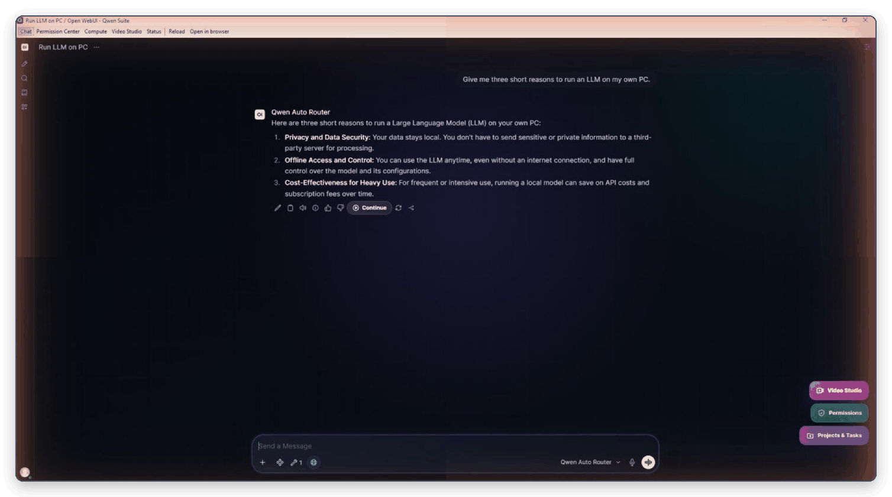</a>
      <p><b>Chat</b> &nbsp;<code>:3000</code><br>
      <sub>Open WebUI in Qwen Suite Desktop. The Qwen Auto Router picks the model for each message; tools were attached, so this answer came from Muse Glimmer 30B.</sub></p>
    </td>
    <td width="50%" valign="top">
      <a href="../docs/screenshots/cards/sign-in.png">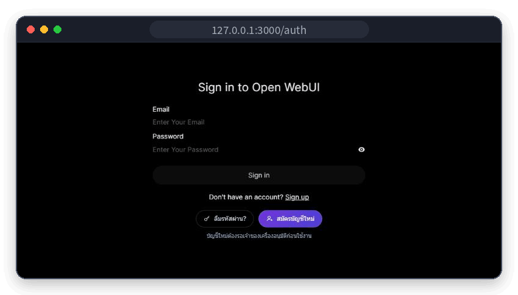</a>
      <p><b>Sign-in with account help</b> &nbsp;<code>/auth</code><br>
      <sub>"Forgot password?" e-mails the owner a one-time reset link. "Sign up" creates an account that waits for the owner's approval.</sub></p>
    </td>
  </tr>
</table>

<sub>From the reference machine on 10 November 2026 (release 1.6.2), with the interface switched to English. Thai is the default; the ไทย | EN switch at the bottom left of every page changes it. The chat is a sample conversation, and video titles are the owner's own (some are in Thai). Click a screenshot to open the full page. Some project names and paths, and a GPU ID, are blurred.</sub>

## Features

| | Area | What you get |
|---|---|---|
| 💬 | **Chat** | Open WebUI with sign-in, a Smart Model Router with seven profiles, RAG with a local reranker, three extra models |
| 🔑 | **Accounts** | A forgot-password link by e-mail for the owner, and sign-up with the owner's approval; other users get the chat, not the PC's tools |
| 🧰 | **Local tools** | 72 MCP tools (files, projects, commands, Office and PDF, charts, reminders, screenshots) behind a Permission Center |
| 🎬 | **Video** | Video Studio turns one prompt into a narrated MP4; the optional Wan 2.2 pack makes short AI clips on a CUDA GPU |
| 🔎 | **Research and knowledge** | Unattended web research to a cited Word report; keyword search over document collections |
| 🖼️ | **Images** | Image generation with the local Qwen-Image pack or Runway, with clear fallback rules |
| 📨 | **Outlook** | Agenda, mail search and drafts only; a morning brief on Telegram at 07:00 |
| 🤖 | **Codex bridge** | The Codex CLI on the local coder model, read-only by default, guarded by the command policy |
| 📱 | **Telegram, WhatsApp, LINE** | The same tools through OpenClaw, local voice notes and Thai speech, automatic reconnect after outages |
| 🌐 | **Remote access** | A text-only internet gateway behind a Cloudflare quick tunnel |
| 🩺 | **Health dashboard** | One read-only report: ports, Ollama, GPU, models, disk, channels, automations, sync, installers |
| ⚡ | **eGPU and CPU** | The right GPU at every Ollama start, with manual and per-model overrides |
| 🖥️ | **Desktop app** | Qwen Suite Desktop: one window for chat and the local pages |
| 🔤 | **Thai or English** | Every suite page and Qwen Suite Desktop in Thai or English with one switch; the add-ons in Open WebUI follow Open WebUI's own language |
| 📦 | **Installers** | Online and Offline 1.6.2, built by a separate project |

### Feature details

Click a name to open it.

<details>
<summary><b>Chat and model routing</b></summary>

- Open WebUI 0.11 runs at `http://127.0.0.1:3000`. Sign-in is required. New accounts can sign up but wait for the owner's approval (see *Accounts* below).
- The **Smart Model Router** (`:8770`) speaks the Ollama API and adds seven model profiles: `qwen-auto`, `qwen-general`, `qwen-code`, `qwen-fast`, `qwen-structured`, `qwen-agent` and `qwen-review`.
- `qwen-auto` picks a model for each request, using English and Thai keyword rules plus message length. The first matching rule wins:

  | Request | Model |
  |---|---|
  | Image or video input | `qwen3.8:27b` (vision) |
  | Code, repositories, debugging | `qwen3-coder:30b` |
  | "Important" requests | `qwen3.8:27b` writes the draft (see *Second pass* below) |
  | Review or second-opinion requests | `muse-glimmer:30b` |
  | Tool-calling turns | `muse-glimmer:30b` |
  | JSON, schemas, extraction, RAG | `granite4.2:8b` |
  | Long conversations (over 1,800 chars), research and "latest" questions | `qwen3.8:27b` |
  | Short messages (up to 320 chars) | `granite4.2:8b` |
  | Anything else | `qwen3.8:27b` |

  A follow-up with no intent words of its own keeps the coding route from the last three user turns. If a chosen model is not installed, the router uses an installed model with a similar role.
- **Second pass:** an "important" request sent to `qwen-auto` (for example "must be correct" or "ส่งผู้บริหาร", "for the executives") is drafted first, then checked and rewritten by Muse Glimmer (or the legacy `gpt-oss:20b` if Muse is missing and that model is installed). An important coding request is drafted by `qwen3-coder:30b` and gets the same second pass.
- **Runner-option normalisation:** the router removes `num_thread`, and also `shift` for models that cannot shift the KV cache. Every caller then loads a model with the same options, so moving between channels does not make Ollama reload a 17 GB model.
- **Extra models (1.6.2)** appear in Open WebUI's model list and are used only when you pick them; `qwen-auto` never routes to them. Their presets match `qwen3.8:27b` Direct (context 32,768, kept loaded for 2 hours, thinking off, the Local Computer Fast tools). All three answered in Thai, made a correct tool call and read an image when tested on the reference machine.

  | Model | Size | What it is |
  |---|---|---|
  | `qwen3.6:35b` | 22.6 GB | Qwen3.6 35B-A3B, mixture of experts with 3B active parameters per token (about 7 tokens/s on the reference CPU) |
  | `gemma4:26b-a4b-it-qat` | 15.6 GB | Gemma 4 26B-A4B, mixture of experts with 4B active, 4-bit QAT (about 7 tokens/s) |
  | `mimo-v2.6:9b` | 6.55 GB | Xiaomi MiMo-V2.6 9B, the official Ollama build: a small coding and agent model with vision and tools. Needs Ollama 0.40.15 or newer |
- **RAG:** hybrid search (BM25 weight 0.4) with `qwen3-embedding:4b` embeddings. The top 8 chunks are reranked to 4 by a local `Qwen3-Reranker-0.6B` service (`:8771`, CPU). Chunk size is 800 with an overlap of 120.
- Long chats are compacted, and chat titles are generated, with `qwen-fast` (Granite).
- Slash prompts `/plan`, `/review`, `/summary`, `/letter`, `/minutes` and `/drawing` (Thai), plus prompt suggestions.
- Voice input uses local faster-whisper with VAD. `ai-services/dictate.ps1` adds push-to-talk dictation anywhere in Windows (Ctrl+Alt+D through its Start Menu shortcut): it records the microphone, transcribes locally, copies the text to the clipboard and deletes the audio.
- Scripts added to Open WebUI: a dark theme, auto-continue for answers that were cut off (up to 6 segments) and buttons that open Projects & Tasks, Permission Center and Video Studio.

</details>

<details>
<summary><b>Accounts: forgot password and sign-up</b></summary>

Two buttons sit under the Open WebUI sign-in form: "ลืมรหัสผ่าน?" (forgot password) and "สมัครบัญชีใหม่" (sign up). They are added by `theme/qwen-account.js`, which `start-webui.ps1` copies into Open WebUI on every start. New in the r5 rebuild of 1.6.2.

- **Forgot password** opens a small panel served by the local tools (`local-tools/account_recovery.py` and `account.html`, at `/account/forgot` on `:8765`). For the owner's account it e-mails a single-use reset link from the owner's Gmail:
  - The link is valid for 15 minutes and points at `127.0.0.1:8765/account/reset`, so it opens only on this PC. The token sits in the URL fragment, which browsers do not send to the server, and the suite keeps only its SHA-256 hash.
  - The new password (at least 8 characters, at most 72 bytes) is written as a bcrypt hash into Open WebUI's `auth` table for that one account, the way Open WebUI stores passwords itself.
  - Only admin accounts with a recovery address get a link. Every other address gets the same neutral answer, and the owner resets other users in Admin Panel › Users.
  - Limits: 3 links per account and 10 in total per hour, at least a minute apart. 20 wrong links in 10 minutes pause the page.
- **One-time setup:** `local-tools\Setup-RecoveryEmail.cmd` asks for the Gmail address, a Google App Password (the account needs 2-Step Verification) and the address that receives the links. It sends a test e-mail before it saves anything. The App Password is stored with Windows DPAPI for the current Windows user, in `data\secrets\recovery-smtp.bin`. The setup reads the admin accounts straight from Open WebUI's database, so it also works when the owner is already locked out.
- **Sign up** is Open WebUI's own form with `ENABLE_SIGNUP=True` and `DEFAULT_USER_ROLE=pending`. A new account can do nothing until the owner approves it in Admin Panel › Users. The owner gets a Windows notification, and a Telegram message when notifications are set up, for each new account.
- **What other users get:** the suite's model presets are shared read-only with all users, but the MCP tool servers stay owner-only, and the Permission Center, Video Studio and Projects & Tasks buttons are hidden for them. The `:8765` pages themselves have no sign-in, so anyone who can use this PC can still open them directly.
- Tested before going live: 64 unit checks with the real bcrypt and DPAPI on the reference machine, 35 browser checks, and the database change applied to a copy and reverted exactly. The owner then reset a forgotten password through the e-mailed link.

</details>

<details>
<summary><b>Local tools and permission gateway</b></summary>

- `local-tools/server.py` (`:8765`) is an MCP server with **72 tools**. They cover files, projects and project memory, commands, background tasks, media, AI video clips, Office documents, PDFs, charts, reminders, research, Codex jobs, knowledge search, Outlook, screenshots, image generation, compute selection, suite status and web search.
- Two compact MCP gateways (`local-tools/fast_server.py`) expose only `local_read` and `local_action`. Port `:8766` serves Open WebUI and port `:8767` serves OpenClaw. Every call goes to `/gateway/dispatch` on `:8765`, where the **Permission Center** applies the policy for that source. `local_read` can batch up to five reads, and `action=help` returns the action catalogue. Keeping the always-attached schema small matters on a CPU: it shrank from 13,077 to 907 bytes.
- **Projects:** each project is an isolated folder under `E:\qwen-projects\<project>` with its own `MEMORY.md`, attachments and outputs. Named path aliases are either `read_only` or `read_write`.
- **Project sync into Open WebUI:** project folders, memories and attachments are mirrored into Open WebUI's folders, memories and files. The tools sign in with the owner's own Open WebUI API key, which they read from Open WebUI's database each time and never copy. Anything that could not be synced (for example while Open WebUI was down) is retried when Open WebUI answers again and every 10 minutes while something is pending. A memory that already exists in Open WebUI with the same text is linked, not duplicated. The state is kept in `data\project-sync.json` and shown on the health dashboard.
- **Files:** targeted text edits (`edit_text_file`). A copy is saved before every edit or overwrite (files over 25 MB are not copied) and kept for 30 days, up to 300 MB in total. `revert_file_change` restores a copy, and the Path Manager shows the change list.
- **Commands:** `run_command` accepts a fixed set of program aliases (cmd, powershell, conda, python, git, ffmpeg/ffprobe/ffplay, VS Code, Explorer), and every call passes the command policy. Long jobs use `start_project_task`, which keeps a persistent task registry with logs, status and end-of-task notifications. Each project can save up to 9 named actions.
- **Documents:**
  - Create Word, Excel, PowerPoint or PDF files from Markdown or JSON (Thai text is set in TH Sarabun New).
  - Edit existing Office files into a new copy. Excel formulas are recalculated through LibreOffice.
  - PDF tools: merge, split, extract, rotate, fill forms, and render pages to PNG.
  - PNG charts.
  - Thai templates `memo-th` and `report-th`, plus templates saved from the user's own files.
- **Local web pages on `:8765`:** `/path-manager`, `/permissions`, `/compute`, `/video-studio` and `/status`.
- **Notifications:** when background work ends, the owner gets a Windows toast, a Telegram message, or both.
- **Reminders:** a Thai/English time parser, delivered to Telegram by an OpenClaw automation with no model call.
- **Screenshots:** `capture_screen` saves a PNG to the project's outputs folder.

</details>

<details>
<summary><b>Video Studio</b></summary>

- A single prompt starts one monitored job, either through `generate_video` or at `http://127.0.0.1:8765/video-studio`. The job runs these steps:
  1. **Storyboard:**
     - English uses `granite4.2:8b`.
     - Thai uses an instant built-in template, unless a large GPU (20 GB or more) is present.
     - With a large GPU, `qwen3.8:27b` writes the storyboard.
  2. **Scene cards:** rendered with Pillow.
  3. **Narration:** Microsoft Edge online voices. If those fail, the offline Windows SAPI voice is used.
  4. **Background music:** generated tones, ducked under the narration.
  5. **Subtitles:** selectable `mov_text` subtitles.
  6. **Video:** an H.264 MP4 in 9:16, 16:9 or 1:1.
  7. **Quality checks:** loudness measurement, preview frames and stream checks.
- Six visual styles are available.
- Each step leaves a checkpoint. Failed jobs resume automatically, up to three attempts. A supervisor keeps the Open WebUI chat attached to the job across page refreshes.

</details>

<details>
<summary><b>AI video clips (optional Wan 2.2 pack)</b></summary>

- `generate_ai_video` (`local-tools/video_gen.py`) makes short AI clips on the PC: 1–5 seconds, 1280×704 or 704×1280, 24 fps, no sound. Clips are saved to the project's outputs folder.
- It runs **Wan2.2 TI2V-5B** on **ComfyUI** (`127.0.0.1:8190`), which starts on first use and frees the GPU memory after every clip.
- It needs an NVIDIA CUDA GPU with compute capability 7.5 or higher and at least 8 GB of VRAM (an eGPU works).
- The pack is a separate download (`Wan-2.2-Optional-Pack-v1.0.zip`), outside the main installer. The tool is enabled only when `optional\wan-2.2\install.json` exists, which the pack writes after its GPU check passes. Without the pack the tool answers `status=not_installed` with install steps.
- A clip takes several minutes, so the tool returns `status=running` with a `task_id`; call it again with the same `task_id` to collect the result.
- Permission category: media editing (`media_write`).

</details>

<details>
<summary><b>Research</b></summary>

- `start_research` runs unattended web research and produces a Word report:
  1. Search DuckDuckGo through `ddgs`.
  2. Fetch the result pages, but only from hosts with public IP addresses.
  3. Write notes for each source.
  4. Write the synthesis.
  5. Check citations: every `[n]` must point to a page that was actually fetched. The reference list is built by code, not by the model.
- The model phase waits until Ollama has been idle for 15 minutes, or for the 01:00-05:00 window. Checkpoints allow `resume_id`. Up to 3 jobs can be active at once.

</details>

<details>
<summary><b>Image generation</b></summary>

- `generate_image` takes `provider=auto|local|runway`:
  - **Local:** Qwen-Image 2.1 is used only when its optional pack is installed. The pack records the install after a CUDA check passes. The pack is not part of this repository.
  - **Runway:** `gen4_image` through a developer API key that the owner stores in `data\credentials\runway-api-key.txt`. Each image costs credits: 5 at 720p, 8 at 1080p.
  - **Fallback rules:** `auto` falls back to Runway only when the local pack cannot run (no CUDA, out of memory) and the request has no `seed` and no local reference image. `local` never falls back.
- Open WebUI is also set up with two Runway MCP connections. The owner signs in with OAuth after installation.

</details>

<details>
<summary><b>Knowledge base</b></summary>

- A BM25 keyword index over PDF, DOCX, XLSX/XLSM, PPTX and text files:
  - Thai text is indexed as character trigrams and CJK as bigrams.
  - Pages without a text layer get Tesseract OCR.
  - Rebuilds are incremental.
  - Values that look like credentials are redacted before indexing.
  - Source files are opened read-only.
- Queries need no model and return file, page, sheet and row locators. They are available through `search_knowledge` and `list_knowledge` in chat, or the `knowledge_base.py build|search|create|list` CLI.

</details>

<details>
<summary><b>Outlook</b></summary>

- Uses classic Outlook through COM:
  - Calendar agenda for up to 14 days.
  - Mail search.
  - `outlook_create_draft`, which saves to Drafts. The module never calls `Send`.
- Every COM call runs in a child process with a 45-second limit. Mail and calendar text is labelled as untrusted for the model.
- **Morning brief:** `local-tools/morning_brief.py` prints a fixed-format Thai summary with no model involved: the date, today's calendar, unread mail, reminders and a one-line suite status. It is meant to run as an OpenClaw automation (`qwen-morning-brief`, 07:00) that posts to Telegram.

</details>

<details>
<summary><b>Codex bridge</b></summary>

- `local-tools/codex/` runs the OpenAI Codex CLI against local Ollama (`qwen3-coder:30b`), with its own `CODEX_HOME` generated from a template:
  - Analytics, web search and cloud features are off.
  - A dead proxy (`127.0.0.1:9`) is a best-effort block on network access for the commands it runs.
- `Invoke-QwenCodex.ps1` modes:
  - `-Exec`: one job; read-only by default.
  - `-Review`: reviews uncommitted changes, a branch or a commit and writes a Markdown report; `-Docx` adds a Word copy.
  - `-Tui`: interactive session.
  - `-List`, `-Check`: list recent jobs, check the setup.
  - JSON output-schema validation and `-ResumeLast` are also supported.
- **Write jobs** need `write_mode` in `data\codex-bridge.json`. The default is `disabled`; the alternatives are `windows-sandbox` and `full-access`.
- **Policy hook:** a `PreToolUse` hook (`policy_hook.py`) applies the same command policy as `run_command`. The bridge self-tests the hook and checks its trust before every job, and refuses write jobs if either check fails.
- **From chat:** `start_codex_job`, `get_codex_job` and `list_codex_jobs`. Jobs from chat are refused in the suite folder, the profile root, AppData, drive roots and secret folders. If a job touched a secret path, its answer is not shown in chat; in other answers, strings that look like secrets are masked.

</details>

<details>
<summary><b>Telegram and WhatsApp via OpenClaw</b></summary>

- `Configure-OpenClaw.py` writes the OpenClaw configuration:
  - Agent `qwenlocal` on `ollama/qwen-auto:latest`, routed through `:8770`.
  - Gateway on `127.0.0.1:18789` with token authentication.
  - Telegram, WhatsApp and LINE channels are all created **disabled** until the owner links them. Once linked: Telegram uses DM pairing, WhatsApp an allowlist plus self-chat, and groups stay off.
  - Local tools through the `:8767` permission gateway.
- Voice notes are transcribed locally. faster-whisper `small` is used when it is installed and the clip fits the time budget; otherwise `base`.
- Voice replies use local Thai TTS (MMS-TTS Thai).
- Memory search is keyword-only (trigram), so no memory text is sent to an embeddings API.
- Skills: `/plan`, `/letter`, `/minutes`, `/drawing` and `/qstatus`. `/model` switches between the router profiles.
- `openclaw-tools/Connect-OpenClaw-Channels.ps1` is an interactive menu for linking Telegram, WhatsApp and LINE.
- **Channel watchdog (1.6.2):** when the network is down for more than about six minutes, OpenClaw retries WhatsApp 12 times, then stops it with a "terminal disconnect" and does not try again. `local-tools/channel_watchdog.py`, started by the tools server, handles this case:
  - It reads the new lines of OpenClaw's log once a minute.
  - When a channel has given up, it waits until the service's host name resolves again, then asks the gateway whether the account is still linked and the channel was stopped by OpenClaw.
  - It then calls OpenClaw's non-destructive `channels.start`, which keeps the pairing: no logout, no new QR code, no gateway restart.
  - At most 3 restarts per channel per hour, at least 5 minutes apart.
  - It never touches a session that was logged out or replaced (WhatsApp codes 401, 403, 411, 440, 500), a channel that OpenClaw is still reconnecting, or a channel stopped by hand. The health dashboard asks for a new QR login instead.
  - It records times, channel names and outcomes only, in `logs\channel-watchdog.log` and `data\channel-watchdog.json`. Set `QWEN_CHANNEL_WATCHDOG=0` to turn it off.

</details>

<details>
<summary><b>Remote access via the internet gateway</b></summary>

- `internet-gateway/server.py` (`:8780`) is a text-only prompt gateway. It uses a fixed model (`qwen3.8:27b`) and **sends no tools** to the model.
- It is published through a Cloudflare quick tunnel (`cloudflared`, random `*.trycloudflare.com` URL).
- A watchdog checks the tunnel's `/ready` endpoint every 120 seconds and backs off when repairs fail. When the URL changes, the owner is notified (Telegram and toast) and the LINE webhook is registered again.
- It offers a web client, a REST API and LINE:
  - REST: `POST /api/v1/prompt` with a Bearer key and an `Idempotency-Key`, job polling, and `/continue`.
  - LINE: a Messaging API webhook with an HMAC-SHA256 check and a pairing code that expires after 30 minutes.
- Optional web search (`ddgs`) with cited sources.
- Per-session memory is stored in SQLite and kept for 30 days.
- Limits: 2 active jobs and 20 jobs per hour per source, and a 30-minute job timeout.
- The setup page (`/local/setup`, which shows the API key and pairing code) only answers direct loopback requests.

</details>

<details>
<summary><b>Health dashboard</b></summary>

- `http://127.0.0.1:8765/status`, the `suite_status` chat action, Telegram `/qstatus` and `local-tools/Test-QwenSuite.ps1` all show the same read-only report from `local-tools/suite_health.py`. It covers:
  - Ports.
  - Ollama's current state, with tokens/s and an ETA.
  - Ollama and GPU configuration.
  - **Models:** every model tag named in the suite's code and config, compared with what Ollama has installed.
  - Display adapters.
  - Disk space.
  - Telegram and WhatsApp.
  - OpenClaw automations.
  - OAuth expiry.
  - Project sync into Open WebUI.
  - README tool count.
  - Installer payload.
  - Stuck processes.
- It never restarts anything or loads a model, and stops after about 15 seconds. Tokens, keys, emails and IDs are redacted. The page refreshes the light checks every 15 seconds and only accepts its own `Host` header.
- **OpenClaw checks (1.6.2):** the OpenClaw CLI takes about 3 seconds when warm and more than 10 seconds right after a start or next to other checks. Its calls now run in the background for up to 45 seconds. A report waits only until its own deadline (13 seconds; 30 seconds in the console) and otherwise shows the last good answer with the time it was read. The tools server reads both 90 seconds after it starts, so the first report already has an answer.
- **Channel outages** are counted once, at the time the channel actually stopped. The Telegram/WhatsApp line says whether the watchdog reconnected the channel, will do so when the internet is back, or needs a new QR login.
- `Test-QwenSuite.ps1` exit codes: `0` normal, `1` worth a look, `2` problem, `3` check could not run.

<p align="center"><a href="../docs/screenshots/health-dashboard-models.png">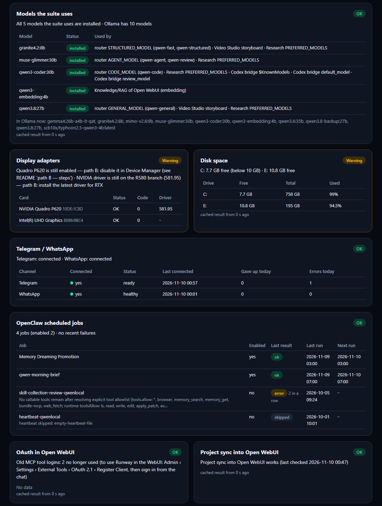</a><br>
<sub>The lower half of <code>/status</code>: models, display adapters, disk, channels, automations, OAuth and Project sync.</sub></p>

</details>

<details>
<summary><b>eGPU / CPU auto-selection</b></summary>

- `Resolve-OllamaGpu.ps1` runs before every Ollama start:
  - **Usable NVIDIA GPU present** (compute capability ≥ 7.0, ≥ 6 GiB, driver ≥ 550): Ollama gets only that card, by UUID, with the `cuda_v12` library and Vulkan off.
  - **No usable GPU:** Ollama runs CPU-only (or keeps its own GPU discovery).
  - The decision goes to `data\gpu-profile.json`, which the router and the video worker read.
- `watch-ollama-gpu.ps1` checks every 45 seconds for a card being plugged in or pulled out, and for sleep while an eGPU was in use. It restarts Ollama when Ollama is idle, with a rate limit.
- **Manual choice:**
  - `Select-QwenCompute.ps1`, the `/compute` page or the chat tool `compute_device`: `auto`, `cpu` or a specific GPU, optionally for a set number of hours.
  - `Set-QwenModelPlacement.ps1` pins one model to the CPU, and the change can be undone byte for byte.
  - The User environment variable `QWEN_GPU_MODE` (`auto|cpu|all|vulkan`) overrides the automatic choice.
- **Diagnostics:** `Test-QwenGpu.ps1` (report, `-SelfTest`, `-Bench`, `-EvictionCheck`) and `bench.ps1`, which runs without unloading models.

</details>

<details>
<summary><b>Qwen Suite Desktop</b></summary>

- `QwenSuiteDesktop.exe` (the **Qwen Suite Desktop** shortcut) is one WebView2 window with buttons for chat, Permission Center, compute device, Video Studio and suite status (Ctrl+1 to Ctrl+5, F5 to reload).
- Only `127.0.0.1:3000` and `127.0.0.1:8765` open inside the app. Other web links open in the default browser, and other schemes (`file:`, `ms-settings:` and so on) are blocked.
- If the suite is not running, the window offers to start Qwen All-in-One.
- It uses its own WebView2 profile (`%LOCALAPPDATA%\QwenSuite\Desktop`), so the first launch asks for the Open WebUI sign-in.
- Tab names, buttons and the "not ready" page are in Thai or English, following the suite's ไทย | EN switch; pressing the switch on a page changes the tabs at once.
- `QwenSuiteDesktop.exe --selftest out.txt` tests the URL policy and the Thai and English tab names. The app is built and shipped by the installer project; it is not part of this repository.

</details>

<details>
<summary><b>Installers</b></summary>

- The Online and Offline installers (current release **1.6.2**, rebuild r6 of 10 November 2026) are built from a separate installer project and distributed separately. They are **not** part of this repository.
  - **Online:** installs the runtimes with winget and downloads the models. An optional *extra models* task adds `qwen3.6:35b`, `gemma4:26b-a4b-it-qat` and `mimo-v2.6:9b`. Each one is skipped, with a warning, if the drive lacks room for it plus a 15 GB reserve, and MiMo is skipped on an Ollama older than 0.40.15.
  - **Offline:** `Qwen-Setup-Offline.exe` plus 35 parts (63.77 GiB) with the Ollama 0.40.15 runtime, the five main models and Qwen Suite Desktop. Installing it over an Offline 1.6.1 install also updates the bundled Ollama runtime: only the suite's own Ollama processes are stopped, the old runtime is kept as `runtime\ollama.old-<version>-<time>`, and it is put back if unpacking fails.
- The installers run `Configure-Qwen-WebUI.py` and `Configure-OpenClaw.py` from this repository to apply the suite's settings.

</details>

## At a glance

| | |
|---|---|
| **Current release** | 1.6.2 (Online and Offline installers, rebuild r6 of 10 November 2026) |
| **Platform** | Windows 10 (tested) or 11, 64-bit, Windows PowerShell 5.1 |
| **Reference machine** | Dell Precision 3551: Intel i7-10750H (6 cores), 64 GB RAM, Quadro P620 4 GB; an RTX eGPU over Thunderbolt 3 is supported |
| **Main models** | `qwen3.8:27b` (general, vision), `qwen3-coder:30b` (code), `muse-glimmer:30b` (agent, review), `granite4.2:8b` (fast, structured, RAG), `qwen3-embedding:4b` (embeddings) |
| **Extra models** | `qwen3.6:35b`, `gemma4:26b-a4b-it-qat`, `mimo-v2.6:9b` (optional, picked directly) |
| **Tools** | 72 MCP tools on `:8765`, reached through two small permission gateways |
| **Channels** | Open WebUI and Qwen Suite Desktop on this PC; Telegram, WhatsApp and LINE through OpenClaw; a text-only internet gateway |
| **Network exposure** | Every service binds `127.0.0.1`; only the text-only gateway is published, through a Cloudflare quick tunnel |

## What's new in 1.6.2

Released 8–9 November 2026. Full details: [CHANGELOG.md](../CHANGELOG.md).

- **Thai or English interface** (rebuild r6, 10 November 2026): a ไทย | EN switch on every suite page and in Qwen Suite Desktop. The pages are still written in Thai, and `local-tools/ui_i18n.js` translates them, including the server's messages, in the browser. Thai is the default.
- **Account help on the sign-in page** (rebuild r5): a forgot-password link by e-mail for the owner, and sign-up with the owner's approval.
- **Project sync into Open WebUI works again.** The tools use the owner's own Open WebUI API key, limited to the folders, memories and files endpoints, and catch up in the background.
- **Telegram and WhatsApp reconnect by themselves** after a network outage: a new channel watchdog restarts a channel that OpenClaw gave up on, once the internet is back.
- **Health dashboard:** OpenClaw checks stay reliable when its CLI is slow, outages are reported at the time they happened, and a new card covers Project sync.
- **Ollama 0.40.15** and three extra models you can pick directly: Qwen3.6 35B-A3B, Gemma 4 26B-A4B and the official MiMo-V2.6 9B.
- **AI video clips** with the new `generate_ai_video` tool and the optional Wan 2.2 pack.
- **Qwen Suite Desktop**, one window for chat, permissions, compute device, Video Studio and status.
- **Installers 1.6.2:** a rebuilt Online installer and a new Offline installer that also updates the bundled Ollama runtime when it installs over Offline 1.6.1. Both were rebuilt again with the account help (r5) and with the Thai or English interface (r6).

## Architecture

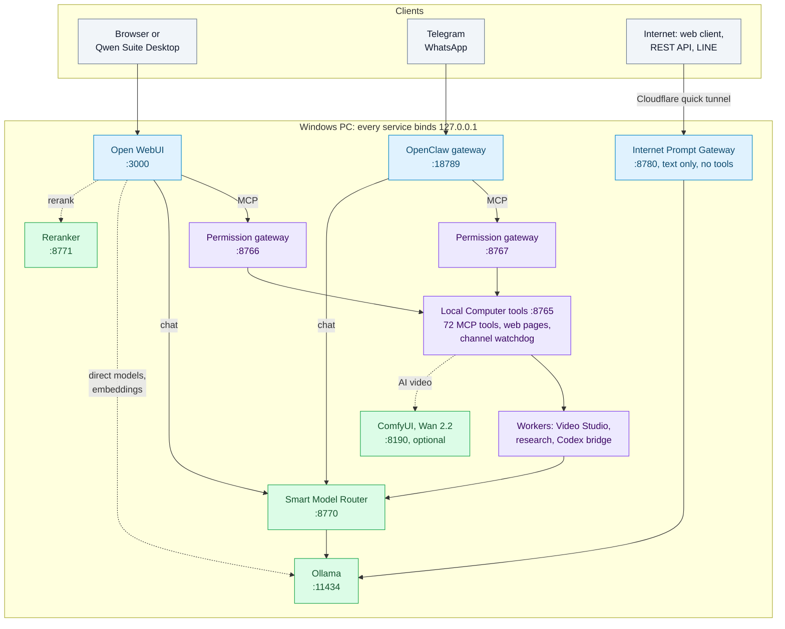

Not drawn, to keep the diagram readable: the GPU scripts (`Resolve-OllamaGpu.ps1`, `watch-ollama-gpu.ps1`) that choose CPU or GPU before Ollama starts; the channel watchdog restarting an OpenClaw channel after an outage; workers that also call Ollama directly; Qwen Suite Desktop opening the `:8765` pages; and the optional cloud services (Runway, DuckDuckGo search, Edge TTS).

| Port | Service | Started by |
|---|---|---|
| 3000 | Open WebUI | `start-webui.ps1` |
| 8765 | Local Computer tools: 72 MCP tools, web pages, `/gateway/dispatch`, channel watchdog, account help | `local-tools/start-local-tools.ps1` |
| 8766 | Permission gateway for Open WebUI | `local-tools/start-local-tools.ps1` |
| 8767 | Permission gateway for OpenClaw | `local-tools/start-local-tools.ps1` |
| 8770 | Smart Model Router | `ai-services/start-ai-services.ps1` |
| 8771 | Qwen3 Reranker | `ai-services/start-ai-services.ps1` |
| 8780 | Internet Prompt Gateway (the only service behind the tunnel) | `internet-gateway/start-internet-gateway.ps1` (via the watchdog that `start-webui.ps1` launches) |
| 8190 | ComfyUI for Wan 2.2 (optional pack only) | `generate_ai_video`, on first use |
| 11434 | Ollama | `start-ollama-server.ps1` / `Start-Ollama.ps1` |
| 18789 | OpenClaw gateway | OpenClaw (`Start-Qwen-All-in-One.ps1` starts it if needed) |

## Requirements

- **OS:** Windows 10 (tested) or 11, 64-bit, with Windows PowerShell 5.1. The scripts use COM, DPAPI, WinRT toasts and `pywin32`, so the suite does not run on Linux or macOS.
- **CPU and RAM:** the reference machine has an Intel i7-10750H (6 cores) and 64 GB RAM. `qwen3.8:27b` (Q4_K_M) has about 17 GB of weights and needs about 18-20 GB of RAM while loaded. Smaller machines have not been tested.
- **Disk:** plan for tens of GB of models. The 1.6.2 offline installer set alone is 63.77 GiB. The extra models need about 45 GB more, and the optional Qwen-Image 2.1 pack at least 50 GB.
- **GPU (optional):** an NVIDIA GPU with compute capability ≥ 7.0, ≥ 6 GB VRAM and a driver ≥ 550 is used automatically. A 24 GB card is recommended for Muse Glimmer and Qwen-Image. Qwen-Image needs CUDA, and the Wan 2.2 video pack needs compute capability 7.5 or higher with at least 8 GB of VRAM. Without a GPU everything runs on the CPU, slowly (see [limitations](#project-status-and-limitations)).
- **Software (source install):**
  - Ollama 0.40.15 (tested). The main models also ran on 0.32.x, but `mimo-v2.6:9b` needs 0.40.15 or newer.
  - Python 3.11 with Open WebUI 0.11.0 in `webui-venv`.
  - The OpenClaw runtime (Node) in `openclaw-runtime`.
  - FFmpeg.
  - Optional, depending on the features you use: `cloudflared` (tunnel), LibreOffice (PDF export, Excel recalculation), Tesseract (OCR), an Anaconda Python with matplotlib (charts), classic Outlook, Microsoft Edge (OpenClaw browser) and the Codex app/CLI (Codex bridge).

## Installation

### Option A: installers

Use the Online or Offline installer (1.6.2). They are distributed separately from this repository. They install the runtimes and, in the offline build, the models. They then apply the configuration with the `Configure-*.py` scripts. After installation, sign in at `http://127.0.0.1:3000` and change the default password (see [Security model](#security-model)). To use the forgot-password link, run `local-tools\Setup-RecoveryEmail.cmd` once.

<details>
<summary><b>Option B: from source (manual)</b>: the steps the scripts expect, for a source install</summary>

There is no bootstrap script. The steps below describe what the scripts expect:

1. Clone into `E:\localllm`. More than 30 tracked files reference that path, and several reference `E:\qwen-projects` and `C:\Users\<user>`.
2. Install Ollama (0.40.15 tested). Set the User environment variables the launchers read: `OLLAMA_MODELS`, `OLLAMA_CONTEXT_LENGTH=32768`, `OLLAMA_KEEP_ALIVE=2h`, `OLLAMA_FLASH_ATTENTION=1` and `OLLAMA_MAX_LOADED_MODELS=2`.
3. Pull the models the suite names:

   ```powershell
   ollama pull qwen3.8:27b
   ollama pull qwen3-coder:30b
   ollama pull granite4.2:8b
   ollama pull muse-glimmer:30b
   ollama pull qwen3-embedding:4b
   # optional extra models, picked directly in Open WebUI
   ollama pull qwen3.6:35b
   ollama pull gemma4:26b-a4b-it-qat
   ollama pull mimo-v2.6:9b
   ```

4. Create `E:\localllm\webui-venv` (Python 3.11) and install `open-webui`. Also install the packages the services import that Open WebUI may not bring:
   - `mcp`, `fastapi`, `uvicorn`, `httpx`, `requests`, `psutil`, `pywin32`, `Pillow`
   - `python-docx`, `openpyxl`, `python-pptx`, `pymupdf`, `ddgs`, `beautifulsoup4`, `lxml`, `jsonschema`
   - `torch`, `transformers`, `huggingface_hub`, `faster-whisper`, `bcrypt`, `edge-tts`
   - `internet-gateway/requirements.txt`
5. Download the local helper models into `model-cache\`:
   - `webui-venv\Scripts\python.exe ai-services\Download-Reranker.py --target E:\localllm\model-cache\Qwen3-Reranker-0.6B`
   - faster-whisper `small` and/or `base` into `model-cache\faster-whisper-small|base`
   - `facebook/mms-tts-tha` into `model-cache\mms-tts-tha`
6. Start the core services with `powershell -ExecutionPolicy Bypass -File E:\localllm\start-webui.ps1`. This one script starts Ollama, the local tools, the router, the reranker and the tunnel watchdog, injects the theme, then serves Open WebUI.
7. Once Open WebUI has created its database, apply the suite settings:
   - `webui-venv\Scripts\python.exe Configure-Qwen-WebUI.py --db E:\localllm\webui-data\webui.db` (this also sets up the API-key access that Project sync uses)
   - After installing OpenClaw into `openclaw-runtime\`: `webui-venv\Scripts\python.exe Configure-OpenClaw.py --root E:\localllm`
8. Day-to-day:
   - `Start-Qwen-All-in-One.ps1` starts everything and opens the browser.
   - `Stop-Qwen-Suite.ps1` or `stop-all.ps1` stops everything and frees the RAM. Both also stop Ollama's `llama-server` children.
   - `openclaw-tools\Connect-OpenClaw-Channels.ps1` links the chat channels.
   - `Restart-QwenOllama.ps1` restarts only Ollama, through the same launcher, so the GPU choice runs again.

</details>

## Configuration

Ports, the Permission Center, owner-editable files, state files, environment variables and what git ignores.

<details>
<summary><b>Configuration details</b>: open for the full list</summary>

- **Ports:** see the [table above](#architecture). All services bind `127.0.0.1`. Open WebUI uses 3000 rather than 8080 because 8080 was taken on the reference machine.
- **Permission Center:** `http://127.0.0.1:8765/permissions`. Eight categories (project read, computer read, memory write, project write, computer write, run programs, task control, media editing) can each be set to `allow`, `ask` or `deny`, separately for `webui` and `openclaw`. Scoped policies per sender or project are also supported. `ask` creates a one-time approval that expires after 15 minutes. Every decision is written to `audit.jsonl`.
- **Owner-editable files** (all under the git-ignored `data\`):

  | File | Purpose |
  |---|---|
  | `data\permission-center\command-rules.json` | Extra blocked-command rules (seeded from `local-tools\default-command-rules.json`, reloaded on change) |
  | `data\permission-center\hooks.json` | Owner Pre/Post hooks. Pre hooks can only block; they fail open after 5 s |
  | `data\compute-selection.json`, `data\model-placement.json` | CPU/GPU choice and per-model CPU pins |
  | `data\codex-bridge.json` | Codex bridge `write_mode` and models |
  | `data\notify.json`, `data\dictate.json` | Notification channels; dictation microphone and language |
  | `data\account-recovery.json`, `data\secrets\recovery-smtp.bin` | Forgot-password e-mail: sender and recovery addresses; the Gmail App Password, encrypted with DPAPI (both written by `local-tools\Setup-RecoveryEmail.cmd`) |
  | `data\credentials\runway-api-key.txt` | Runway developer key (owner-created; blocked for the model's file tools) |
  | `local-tools\allowed-roots.json` | Folders the file tools may use (default: user profile, suite folder, `E:\qwen-projects`, Documents) |

- **State the suite writes** (read by the health dashboard, also git-ignored): `data\project-sync.json` (what is still waiting to sync into Open WebUI), `data\channel-watchdog.json` and `logs\channel-watchdog.log` (channel restarts), `data\gpu-profile.json` (the current GPU decision), `data\account-recovery-state.json` and `data\account-recovery.log` (reset-link hashes, limits and events, never passwords or tokens).
- **Environment variables:** `QWEN_GPU_MODE`, `QWEN_CHANNEL_WATCHDOG` (`0` turns the channel watchdog off), `QWEN_ACCOUNT_WATCH` (`0` turns off the notice about new sign-ups), `QWEN_EXPECTED_MAX_LOADED` (what the health dashboard expects for `OLLAMA_MAX_LOADED_MODELS`, default 2), `QWEN_WHISPER_MODEL`, `QWEN_WHISPER_BUDGET_SECONDS`, `QWEN_RESEARCH_IDLE_MINUTES`, `QWEN_OUTLOOK_ALLOW_START`, `QWEN_OUTLOOK_TIMEOUT` and `QWEN_TESSERACT`. The `OLLAMA_*` variables are read from the User environment by the launchers.
- **Excluded from git:** `.gitignore` is an allowlist. Only the top-level scripts and documents, `ai-services/`, `internet-gateway/`, `local-tools/`, `openclaw-tools/`, `theme/`, this page and its screenshots are tracked. Everything else stays local, including:
  - Data and secrets: `data\`, `webui-data\`, `internet-gateway\data\`, `.webui_secret_key`, `allowed-roots.json`.
  - Logs and caches: `logs\`, `backups\`, `hf-cache\`, `model-cache\`.
  - Runtimes: `webui-venv\`, `openclaw-runtime\`, `runtime\`.
  - Workspaces: `openclaw-workspace\`.
  - File types: databases, `.env`, keys, `credentials*`, archives and binaries.

</details>

## Security model

This is a single-owner setup that deliberately trades confirmations for convenience. Read this section before connecting any chat channel.

- **Loopback only.** Open WebUI, the tool servers, router, reranker, internet gateway, Ollama, ComfyUI and the OpenClaw gateway all bind `127.0.0.1`. Open WebUI accepts browser API calls only from its own origin (`CORS_ALLOW_ORIGIN`). The `:8765` JSON endpoints refuse cross-origin posts, and the status API refuses foreign `Host` headers.
- **Login.** Open WebUI requires a password. The configuration script creates the owner account **`admin@localhost`** with a default password. **Change it at the first sign-in** (Settings > Account). The default password is not printed here, but anyone with the source can read it, so treat it as public.
- **Sign-up and other users.** Anyone at this PC can sign up, but a new account stays *pending* until the owner approves it. Approved users get the chat presets, not the PC's tools.
- **Password reset.** The forgot-password link goes only to the owner's recovery address. It opens only on this PC, works once within 15 minutes and is stored only as a hash. The Gmail App Password is encrypted with Windows DPAPI for the owner's Windows account and is not in the installers.
- **Project sync key.** Open WebUI API keys are limited to `/api/v1/folders`, `/api/v1/memories` and `/api/v1/files`. The tools read the owner's key from Open WebUI's database when they need it and never copy it elsewhere. With that limit the key cannot read chats or user accounts or create new keys (checked: HTTP 403).

<details>
<summary><b>More of the security model</b>: hard blocks, Codex bridge, chat channels, watchdog, desktop app, internet gateway and what leaves the machine</summary>

- **The Permission Center allows everything by default.** For both `webui` and `openclaw`, all eight categories default to **Allow**. As a result, a message from an allowed Telegram/WhatsApp sender can run local commands, write files and start tasks **without a confirmation prompt**. This is the owner's deliberate choice. Set categories to `ask` or `deny` if you want a different trade-off. The protections that still apply under Allow are listed next.
- **Hard blocks, independent of policy:**
  - **File tools:**
    - Limited to the allowed roots.
    - Refuse credential and agent-state folders (`.ssh`, `.aws`, `credentials`, browser `Login Data`/`Cookies`, `.codex`, `.openclaw`, `.claude`).
    - Refuse Open WebUI's database and secret key.
  - **Command policy** (`local-tools/command_policy.py`):
    - Blocks format/diskpart/bcdedit, shutdown, recursive deletes, killing the AI services, credential-store access, agent-state folders, and disk or shadow-copy destruction.
    - Unwraps `powershell -Command`, `-EncodedCommand` (base64), `-File`, `cmd /c` and `python -c`, and normalises aliases before checking.
  - **Limits of these blocks:** this is a block-list, not a sandbox. A script that is already on disk can still do anything the user can.
- **Codex bridge:** write jobs are off by default. In `full-access` mode the model's commands run with the user's full rights, and only the policy hook and the dead proxy stand in the way.
- **Chat channels:** OpenClaw uses DM pairing for Telegram and an allowlist/self-chat for WhatsApp, with groups disabled. Its gateway uses token auth on loopback.
- **Channel watchdog:** it only restarts channels that OpenClaw itself stopped after a network outage, with OpenClaw's documented `channels.start`. It never logs out, re-pairs or restarts the gateway, and its log and state file hold no message text, phone numbers or IDs.
- **Qwen Suite Desktop** opens only the local chat (`:3000`) and tools (`:8765`) pages inside the app, sends other links to the default browser and blocks other URL schemes.
- **Internet gateway:**
  - The only internet-facing path. It sends no tools to the model, so remote prompts cannot control the computer.
  - **Access:** requests need a random API key (Bearer). LINE requests are verified with HMAC-SHA256, and LINE secrets are encrypted with Windows DPAPI.
  - **Limits:** rate and queue limits apply.
  - **Exposure:** the quick-tunnel URL is public and changes on restart, so anyone with the URL and the key can use the model.
- **What leaves the machine:**
  - Web search queries and fetched pages: DuckDuckGo via `ddgs` (research worker, internet gateway), Open WebUI's own web search and web loader, and OpenClaw's `web_fetch` and Edge `browser` tools.
  - Runway prompts and reference images, when Runway is used (the `gen4_image` API and the two Runway MCP connections at `mcp.runwayml.com`).
  - Video narration text, sent to Microsoft's online Edge TTS.
  - Telegram, WhatsApp and LINE messages, including files and screenshots sent back to Telegram.
  - Tunnel traffic through Cloudflare.
  - Open WebUI telemetry is switched off (`ANONYMIZED_TELEMETRY=False`, `DO_NOT_TRACK`, `SCARF_NO_ANALYTICS`).

</details>

## Model and component licences

Models and runtimes are **not** distributed in this repository. Each is downloaded separately under its own licence. Watch out for three of them: MMS-TTS Thai and Qwen-Image 2.1 are non-commercial only, and PyMuPDF is AGPL-3.0.

<details>
<summary><b>Licence table</b>: every model, runtime and service the suite uses</summary>

| Component | Used for | Licence |
|---|---|---|
| Qwen3.8 27B (`qwen3.8:27b`) | General chat, vision, default model | Apache-2.0 |
| Qwen3-Coder 30B (`qwen3-coder:30b`) | Coding, Codex bridge | Apache-2.0 |
| Granite 4.2 8B (`granite4.2:8b`) | Fast/structured/RAG answers, titles, compaction | Apache-2.0 |
| Muse Glimmer 30B (`muse-glimmer:30b`) | Agent and second-opinion review | Apache-2.0 according to its ollama.com page (**to be confirmed** against the upstream model card) |
| Qwen3-Embedding 4B (`qwen3-embedding:4b`) | RAG embeddings | Apache-2.0 |
| Qwen3-Reranker-0.6B | RAG reranking | Apache-2.0 |
| Qwen3.6 35B-A3B (`qwen3.6:35b`, optional) | Extra chat model | Apache-2.0 |
| Gemma 4 26B-A4B (`gemma4:26b-a4b-it-qat`, optional) | Extra chat model | Apache-2.0 |
| MiMo-V2.6 9B (`mimo-v2.6:9b`, optional) | Extra small coding/agent model with vision | MIT |
| faster-whisper small / base | Speech-to-text | MIT |
| MMS-TTS Thai (`facebook/mms-tts-tha`) | Thai voice replies on Telegram/WhatsApp | **CC BY-NC 4.0: non-commercial use only** |
| Qwen-Image 2.1 (optional pack) | Local image generation | **Qwen Research License: non-commercial (research/evaluation) only.** Commercial use needs a separate licence |
| Wan2.2 TI2V-5B (optional pack) | Local AI video clips | Apache-2.0 |
| ComfyUI (optional pack) | Runs Wan 2.2 | GPL-3.0 |
| Open WebUI 0.11 | Chat UI | Open WebUI License (BSD-3-Clause based, with a **branding clause**: do not remove or alter "Open WebUI" branding unless the deployment has ≤ 50 users in 30 days, or you have written permission or an enterprise licence). The bundled theme restyles the UI but does not rename it |
| Ollama | Model server | MIT |
| OpenClaw | Telegram/WhatsApp/LINE gateway | MIT |
| PyMuPDF (`pymupdf`, imported, not included) | PDF tools, knowledge base, research | **AGPL-3.0** or a commercial licence from Artifex. This repository only imports it; an installer that bundles it takes on AGPL obligations |
| Runway API, Edge TTS | Cloud image generation, video narration | Commercial online services under their providers' terms |

Licences were checked on the public model pages in October 2026, and those of the extra models and the Wan 2.2 pack in November 2026. Confirm each one on its model card before any commercial use.

</details>

## Project status and limitations

- **Personal, single-machine project.** It is tuned for one laptop: hard-coded paths (`E:\localllm`, `E:\qwen-projects`, `C:\Users\<user>\...`), Anaconda locations and VS Code paths. Moving it means editing those paths.
- **Windows only.**
- **Thai-first:** the web pages are written in Thai and translated to English in the browser when English is chosen (text that people typed, such as video titles, stays as it is). Most prompts and model messages are in Thai.
- **CPU-only performance is slow:**
  - `qwen3.8:27b` reads prompts at about 5-6 tokens/s and writes at about 1.4-1.9 tokens/s on the reference CPU.
  - A cold OpenClaw prompt (about 20k tokens) takes 13-23 minutes to read.
  - Ollama serves one request at a time, so research and Codex jobs wait for idle time.
  - The eGPU speed figures in the docs are estimates. The eGPU path has not been benchmarked on this machine.
- **Fixed in 1.6.2:** Project sync into Open WebUI, which failed throughout 1.6.1 because the tools still used the pre-1.6.1 sign-in.
- **Not yet verified end to end:**
  - Codex tool-calling quality with `qwen3-coder:30b`, and a full research run.
  - The channel watchdog during a real outage. Its logic is unit-tested, and the `channels.start` call it uses was checked by hand after an outage on 9 November 2026.
  - AI video clips on a CUDA GPU. The reference machine has none, so only the pack installer's GPU checks have been tested.
- **Fragile external pieces:**
  - Quick-tunnel URLs change on every restart and have no SLA.
  - `ddgs` search is best-effort.
  - Outlook support is classic Outlook (COM) only.
- **Packaging gaps:**
  - There is no consolidated `requirements.txt` and no bootstrap script.
  - Automated tests in this repository cover the internet gateway (24 `unittest` cases), the GPU decision logic (`Test-QwenGpu.ps1 -SelfTest`) and the Codex policy hook (`policy_hook.py --selftest`, run before every Codex job). The 1.6.2 health-dashboard and watchdog changes were tested with separate fake-based suites (15 and 13 cases), and the account help with 64 unit and 35 browser checks; none of these suites are part of this repository.

## Repository layout

```text
*.ps1, Configure-*.py   launchers, stop scripts, GPU selection, benchmarks, configuration
ai-services/            model router (:8770), reranker (:8771), speech-to-text, Thai TTS, dictation
local-tools/            MCP tools (:8765), permission gateways (:8766/:8767), workers, channel watchdog, account help, web pages
local-tools/codex/      Codex CLI bridge (templates, policy hook, job tracking)
internet-gateway/       internet prompt gateway (:8780), quick tunnel and watchdog, tests
openclaw-tools/         OpenClaw launch and channel scripts, chat skills
theme/                  Open WebUI theme and add-on scripts
.github/README.md       this page (the GitHub front page)
docs/screenshots/       screenshots used on this page
README.md               the owner's detailed operations manual (Thai)
CHANGELOG.md            release history
GIT-README.txt          git notes for the owner (Thai)
LICENSE                 MIT License for the suite's own code
```

## Changelog

The full release history is in [CHANGELOG.md](../CHANGELOG.md):

- **1.6.2 rebuild r6** (10 November 2026): Thai or English interface for the suite pages and Qwen Suite Desktop, in both installers; screenshots in English.
- **1.6.2** (8–9 November 2026): Project sync fix, channel watchdog, account help (forgot password, sign-up with approval), Ollama 0.40.15, extra models, AI video clips, Qwen Suite Desktop, Online and Offline installers.
- **1.6.1** (1–7 October 2026): Open WebUI sign-in, the `admin@localhost` owner account, the models check on the health dashboard.
- **1.6** (1 October 2026): Muse Glimmer and Granite take over the agent, review, fast and structured roles; optional local Qwen-Image.
- **1.5.0 and 1.4.0** (30 September 2026): Codex from chat, knowledge base, Outlook, morning brief, screenshots, Runway images, Codex-style and Claude-style tools, eGPU support.

## License

The suite's own code is released under the [MIT License](../LICENSE). The third-party models, runtimes and services listed in [Model and component licences](#model-and-component-licences) keep their own licences.

This is an unofficial project, not affiliated with or endorsed by Alibaba Cloud / Qwen, Google, IBM, Meta, Xiaomi, Ollama, Open WebUI, OpenClaw, OpenAI (Codex), Runway or ComfyUI. Product names belong to their owners.
